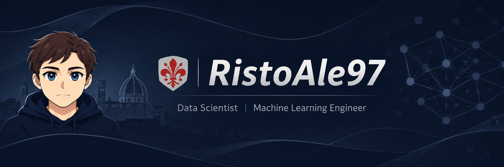

## :it: About me
```python
from world import Human


class Alessandro(Human):
  def __init__(self) -> None:
    self.username = "RistoAle97"
    self.name = "Alessandro"
    self.last_name = "Ristori"
    self.education = {
      "B.Sc.": "Computer Science - University of Florence",
      "M.Sc.": "Computer Science (AI) - University of Pisa",
    }
    self.role = "Big Data & AI Specialist"
    self.company = "TAI Solutions"
    self.main_interests = [
      "Artificial Intelligence",
      "Deep Learning",
      "Natural Language Processing",
    ]
    self.languages = {
      "it_IT": "Native",
      "en_GB": "B2",
      "es_ES": "B1",
    }

  def welcome(self) -> None:
    print(f"Hi! I'm {self.username}, welcome to my profile.")


me = Alessandro()
me.welcome()
```
```console
> uv run python info.py
Hi! I'm RistoAle97, welcome to my profile.
```

## :hammer_and_wrench: Tech stack
> [!NOTE]
> Purple badges indicate technologies I regularly use in personal projects or at work.


| Category | Languages |
| -------- | --------- |
| 🥇 Core |   |
| 🥈 Familiar |      |
| 🎯 Exploring |  |

### Frameworks, Libraries & Platforms
| Category | Packages |
| -------- | -------- |
| 🐍 Python Toolkit | [](https://github.com/astral-sh/uv) [](https://github.com/astral-sh/ruff) [](https://github.com/astral-sh/ty) [](https://github.com/j178/prek) |
| 🤖 Machine Learning | [](https://github.com/pytorch/pytorch) [](https://github.com/tensorflow/tensorflow) [](https://github.com/Lightning-AI/lightning) [](https://github.com/keras-team/keras) [](https://github.com/scikit-learn/scikit-learn) [](https://github.com/opencv/opencv-python) [](https://github.com/ultralytics/ultralytics) |
| 🤗 HF Suite | [](https://github.com/huggingface/transformers) [](https://github.com/huggingface/datasets) [](https://github.com/huggingface/tokenizers) [](https://github.com/huggingface/safetensors) |
| 📓 Notebooks |  |
| ♻️ MLOps | [](https://github.com/wandb/wandb) [](https://github.com/mlflow/mlflow) |
| 🔎 Data Manipulation | [](https://github.com/pandas-dev/pandas) [](https://github.com/pola-rs/polars) |
| 🎓 Scientific Computing | [](https://github.com/numpy/numpy) [](https://github.com/scipy/scipy) [](https://github.com/matplotlib/matplotlib) |
| ⚡ Big Data | [](https://github.com/apache/spark) []((https://github.com/databricks)) |
| 🧩 Backend | [](https://github.com/pydantic/pydantic) [](https://github.com/fastapi/fastapi) [](https://github.com/gradio-app/gradio) |
| 🧪 Testing | [](https://github.com/pytest-dev/pytest) |
| 📖 Documentation | [](https://github.com/zensical/zensical) |

### Skills
| Category | Skills |
| -------- | ------ |
| ☁️ Cloud Computing |  |
| 📦 Containerization |  |

### Development Environment & Productivity
| Category | Tools |
| -------- | ----- |
| ⚙️ Code Editors | [](https://github.com/VSCodium/vscodium) [](https://github.com/zed-industries/zed) |
| 🧭 Browsers |  [](https://github.com/zen-browser/desktop) |
| 🚀 Version Control |    |
| 📝 Notes |    |
| 🖼️ Diagrams |  |
| 🔧 Utilities |    |

## :card_file_box: Github Stats
<div align="center">
  
  
</div>
